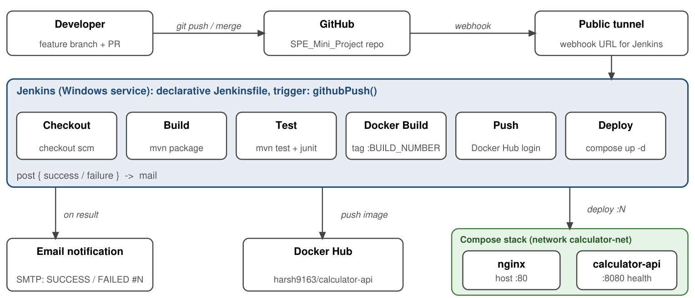

# Calculator REST API: SPE Mini-Project

**CSE 816 Software Production Engineering** | M.Tech (CSE), Term I, 2026-27 | Faculty: Prof. B. Thangaraju
**Student:** Harsh Mohta (IMT2023106)

A Calculator REST API built with **Java 17 + Spring Boot + Maven**, wrapped in an automated CI/CD pipeline:
**GitHub → Jenkins → Docker → Docker Hub → Docker Compose (with an Nginx reverse proxy)**.

- Repository: https://github.com/Harsh-Mohta9163/SPE_Mini_Project
- Docker Hub image: https://hub.docker.com/r/harsh9163/calculator-api
- Report: [`IMT2023106_Harsh_Mohta.pdf`](IMT2023106_Harsh_Mohta.pdf)

---

## Architecture



*Flow from a developer push to a health-checked deployment. Shaded green: containers started by the Deploy stage.*

## Tech stack

| Layer         | Technology                              |
|---------------|-----------------------------------------|
| Language      | Java 17                                 |
| Framework     | Spring Boot 3.3.4 (Web + Actuator)      |
| Build         | Maven                                   |
| Testing       | JUnit 5 + Spring MockMvc (22 tests)     |
| CI/CD         | Jenkins, declarative Jenkinsfile        |
| Container     | Docker, multi-stage, non-root user      |
| Orchestration | Docker Compose (API + Nginx)            |
| Registry      | Docker Hub                              |
| VCS           | Git / GitHub (feature branches + PRs)   |

---

## REST API

| Method | Endpoint                  | Behaviour                                  |
|--------|---------------------------|--------------------------------------------|
| GET    | `/api/v1/add?a=&b=`       | Returns a + b                              |
| GET    | `/api/v1/subtract?a=&b=`  | Returns a - b                              |
| GET    | `/api/v1/multiply?a=&b=`  | Returns a * b                              |
| GET    | `/api/v1/divide?a=&b=`    | Returns a / b; b = 0 gives HTTP 400        |
| GET    | `/actuator/health`        | Spring Actuator health probe (UP/DOWN)     |

Success (HTTP 200):
```json
{"operation":"add","a":10.0,"b":20.0,"result":30.0}
```

Errors (HTTP 400, JSON body):
```json
{"error":"Division by zero is not allowed","a":10.0,"b":0.0}
{"error":"Missing required parameter: b","a":0.0,"b":0.0}
{"error":"Invalid value for parameter 'a': must be a number","a":0.0,"b":0.0}
```

---

## Getting started

Prerequisites: Java 17+, Maven 3.8+, Docker with Docker Compose.

```bash
mvn clean package          # build the executable JAR
mvn test                   # run 22 tests; JUnit XML goes to target/surefire-reports/
java -jar target/calculator-1.0.0.jar      # run locally on :8080
```

### Run the image on its own
Host port 8080 is usually taken by Jenkins, so map to 8081:
```bash
docker build -t calculator-api .
docker run -p 8081:8080 calculator-api
curl http://localhost:8081/actuator/health
```

### Run the full stack (API + Nginx)
```bash
docker compose up -d
docker compose ps          # calculator-api should show (healthy)
```
The API is then served through Nginx at `http://localhost/`.

### Try it
```bash
curl -s -w "\nHTTP %{http_code}\n" "http://localhost/api/v1/add?a=10&b=20"
curl -s -w "\nHTTP %{http_code}\n" "http://localhost/api/v1/subtract?a=20&b=5"
curl -s -w "\nHTTP %{http_code}\n" "http://localhost/api/v1/multiply?a=6&b=7"
curl -s -w "\nHTTP %{http_code}\n" "http://localhost/api/v1/divide?a=20&b=4"
curl -s -w "\nHTTP %{http_code}\n" "http://localhost/api/v1/divide?a=10&b=0"      # 400
curl -s -w "\nHTTP %{http_code}\n" "http://localhost/actuator/health"
```

### Smoke test (all endpoints, one command)
```bash
python scripts/smoke_test.py            # or: bash scripts/smoke_test.sh
```

---

## CI/CD pipeline (Jenkins)

Defined in [`Jenkinsfile`](Jenkinsfile) and triggered automatically by a GitHub push webhook (`githubPush()`).

| Stage        | What it does                                                                 |
|--------------|------------------------------------------------------------------------------|
| Checkout     | `checkout scm`, pulls the commit that triggered the build                    |
| Build        | `mvn clean package -DskipTests -B`                                           |
| Test         | `mvn test -B`; JUnit results published; a failing test fails the build       |
| Docker Build | Builds the image tagged `harsh9163/calculator-api:<BUILD_NUMBER>` and `:latest` |
| Push         | `docker login` with the `dockerhub-creds` credential, then pushes both tags  |
| Deploy       | `docker-compose up -d --force-recreate`, then `scripts/smoke_test.py`        |
| post         | Email on success or failure; `docker logout`                                 |

Re-running the pipeline is safe: Deploy recreates the same Compose project instead of starting a second stack.

### Jenkins setup
1. **Job:** a Pipeline job named `calculator-devops-pipeline`, *Pipeline script from SCM*, this repository, branch `main`, script path `Jenkinsfile`. Run it once manually so Jenkins registers the trigger.
2. **Credential:** Manage Jenkins → Credentials → (global) → *Username with password*:
   - ID `dockerhub-creds` (exactly)
   - Username: your Docker Hub username (`harsh9163`), with no leading or trailing space
   - Password: a Docker Hub **access token** with Read & Write permission
3. **Webhook:** GitHub repo → Settings → Webhooks → payload URL `https://<public-url>/github-webhook/`, content type `application/json`, event *Just the push event*. GitHub cannot reach `localhost`, so Jenkins needs a public tunnel URL.
4. **Email:** configure SMTP under Manage Jenkins → System (E-mail Notification) and set *System Admin e-mail address* under Jenkins Location. Jenkins also uses the notification address set in `NOTIFY_EMAIL` in the Jenkinsfile.
5. **Windows host:** Jenkins runs as a service, so the tools it calls must be reachable:
   - Add `C:\Program Files\Git\bin` and `C:\Program Files\Git\usr\bin` to the **system** `PATH` (the Jenkinsfile uses `sh` steps through Git Bash), then run `Restart-Service Jenkins`.
   - The Jenkinsfile's `environment { PATH }` adds Maven, Docker Desktop and Python. Adjust those paths for your machine.
   - The service account cannot see the user-level `docker compose` plugin, so the Jenkinsfile calls the standalone `docker-compose` binary.

---

## Docker and Compose

- **Dockerfile:** stage 1 `maven:3.9.6-eclipse-temurin-17-alpine` resolves dependencies first (cached layer) and builds the JAR; stage 2 `eclipse-temurin:17-jre-alpine` copies only the JAR, runs as the non-root user `appuser`, declares `EXPOSE 8080` and has a `HEALTHCHECK` on `/actuator/health`. `.dockerignore` excludes `target/`, `.git/` and IDE files.
- **docker-compose.yml:** `calculator-api` (health check, `restart: unless-stopped`, `SPRING_PROFILES_ACTIVE=prod`, port exposed only inside the network) and `nginx` (the only published port, 80, proxying to the API once it is healthy), both on the `calculator-net` bridge network.

---

## Project structure

```
.
├── src/
│   ├── main/java/com/spe/calculator/
│   │   ├── CalculatorApplication.java
│   │   ├── controller/CalculatorController.java
│   │   ├── service/CalculatorService.java
│   │   ├── dto/{CalculatorResponse,ErrorResponse}.java
│   │   └── exception/{DivisionByZeroException,GlobalExceptionHandler}.java
│   ├── main/resources/application.properties
│   └── test/java/com/spe/calculator/
│       ├── service/CalculatorServiceTest.java        # 13 JUnit 5 unit tests
│       └── controller/CalculatorControllerTest.java  # 9 MockMvc integration tests
├── scripts/
│   ├── smoke_test.py / smoke_test.sh                 # deployment verification
│   └── generate_pdf_report.py                        # builds the PDF report
├── docs/architecture.png                             # pipeline architecture diagram
├── screenshots/                                      # A1-A6 report screenshots
├── pom.xml
├── Dockerfile
├── .dockerignore
├── docker-compose.yml
├── nginx.conf
├── Jenkinsfile
├── IMT2023106_Harsh_Mohta.pdf                        # project report
├── .gitignore
└── README.md
```

## Version control

Work was done on feature branches (`feature/spring-boot-api`, `feature/docker-and-compose`, `feature/jenkins-and-pipeline-deliverables`) and merged into `main` through pull requests #1 to #3. `.gitignore` excludes `target/`, IDE files and secrets. No credentials are in the repository; the Docker Hub token lives only in the Jenkins credentials store.

## Regenerating the report
```bash
python scripts/generate_pdf_report.py     # writes IMT2023106_Harsh_Mohta.pdf
```

